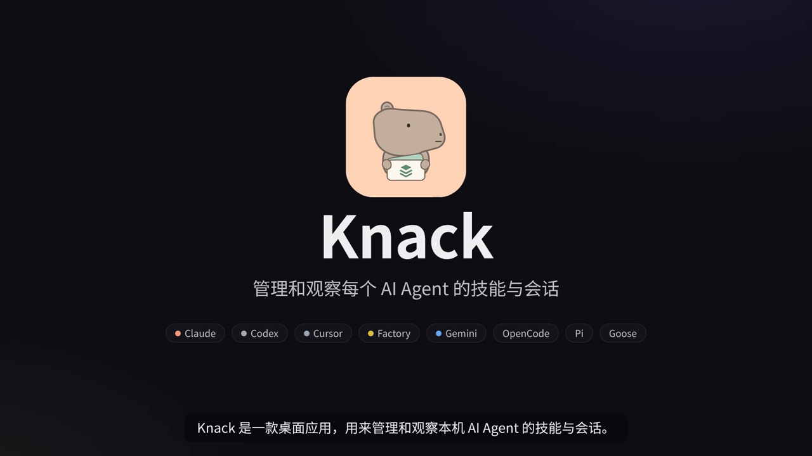

<p align="center">
  
</p>

<h1 align="center">Knack</h1>

<p align="center">管理和观察每个 AI Agent 的技能与会话。</p>

Knack 是一款面向 Windows、Linux 和 macOS 的桌面应用，用来管理本机的 AI Agent skills。把分散在 Claude、Codex、Cursor 等工具中的技能放到一个视图里，查看来源、共享技能、检查断链，并比较同名副本。

以磁盘上的 `SKILL.md` 和目录为准，用共享池与软链连接不同 Agent。

<p align="center">
  <a href="docs/knack-intro.mp4"></a>
</p>

<p align="center"><a href="docs/knack-intro.mp4">观看 71 秒介绍视频</a>：技能库、共享池、待处理、会话统计与诊断。画面中为示例数据。</p>

## 功能

| 功能 | 能做什么 |
| --- | --- |
| 技能库 | 按来源（共享池、仓库、Agent、自带）列出全部技能，按已挂载 / 未挂出 / 有问题筛选；详情显示挂载关系图、独立副本提醒，以及 SKILL.md / 文件 / 依赖 / 关联会话 |
| 搜索 | 侧栏一个搜索框同时查技能名称、说明、路径和会话；在全部会话页直接筛选会话 |
| 共享池 | 将本地仓库中的技能链接到 `~/.agents/skills`，再链接到不同 Agent |
| 会话详情 | 会话列表与概览/耗时 tab，查看每轮步骤瀑布图、元信息与长步骤折叠，支持键盘下钻和返回 |
| Agent 页面 | 技能 / 会话 / 用量三个 tab，按 Agent 查看 Token 构成、模型输出速率和 Skill / 工具调用排行；没有日志的 Agent 显示原因 |
| 技能使用情况 | 查看近 7/30/90 天调用次数、最后使用时间和关联会话；只统计日志中明确记录的 Skill 名称 |
| 首页与全部会话 | 只读统计 Claude / Codex / Factory 本地会话：首页一页看待处理、最近会话、近 52 周活跃热力图、连续活跃纪录、一天中的节奏，以及 Token 构成、按轮累加的耗时构成、模型输出速率和调用排行；其他日志可通过 [自定义 Agent](docs/agents.md) 接入，插件可从 GitHub、本机目录、`.js` 文件或 ZIP 安装 |
| 待处理 | 按类别分组列出断链、同名副本差异、一致副本、未挂出的共享技能、空目录和耗时异常；按需比较副本，确认一致或存在差异 |
| 修复与撤销 | 单项处理或批量修复可安全处理的问题，修改前确认，完成后可撤销 |
| 依赖图 | 文件级：选一个技能，查看目录内文件之间的引用（链接、路径、source）、引用的其他技能和缺失文件，标出引用所在行 |
| 会话诊断 | 会话页上方按模型调用画出上下文构成，标出缓存重建及原因；列出疑似循环、连续失败、被中断或疑似被纠正的轮次、长期占用上下文的大段工具结果，点击直达对应步骤 |
| 诊断 | 费用估算（可补充价格表）、每个会话开局占用的上下文、技能常驻开销与 90 天未调用 / 描述问题 / 描述相近、按真实会话评测技能（触发方式、加载后是否顺利、改动前后对比，可导出 skill-creator 的触发评测集）、工具失败与疑似循环、按项目汇总，以及各层 CLAUDE.md / AGENTS.md、MCP、hooks 和权限规则；详见 [诊断](docs/insights.md) |
| 生效视图 | 按 Agent 和工作目录查看会加载哪些技能、同名技能的覆盖关系、逐层查找路径和仍占用磁盘的副本 |
| 仓库管理 | 添加本地技能仓库，设置显示名称与扫描路径 |
| Claude 调用设置 | 调整用户级自动调用、仅手动调用或禁用设置 |

Knack 识别 Claude、Codex、Cursor、Factory、Gemini、OpenCode、Pi、Goose 等工具的已知技能目录。只显示本机已存在或需要报告访问错误的目录，自带技能与 `.system` 内容只读。Windows 上也会识别 Goose 的 `%APPDATA%\Block\goose\config\skills`。

会话统计只读本地日志，缓存只保存元信息，不保存 prompt、助手正文、工具参数或输出；工具参数只保存截断的 SHA-256 指纹，用于发现重复调用；工具结果只保存字节数，技能加载只保存名称、目录、估算的 Token 和是否用到自带文件。“轮次”页按轮回放对话：打开会话时从原始日志按需读取 prompt、思考、回复、工具输入/输出和自动注入的上下文（如 Codex 的系统提示词），只保留在内存中。Factory 的 Token、Codex 的工具失败、Cursor 的会话日志等缺失能力会明确说明“暂不支持”。技能使用记录按调用名匹配，不能据此区分同名副本或判断长期未使用。

生效视图目前按「项目 → 全局 → 共享池 → 内置」推演同名覆盖关系。实际加载行为仍以各 Agent 的规则为准。依赖图中的正文引用包含推断结果。

## 下载安装

在 [Releases](https://github.com/Maidang1/knack/releases/latest) 下载最新版本：macOS 使用通用 `.dmg`，Windows 按架构选择 `.exe`，Linux 按架构选择 `.deb` 或 `.tar.gz`。Linux 归档用户需同时下载 `install.sh`，与归档放在同一目录后运行 `sh install.sh`。`SHA256SUMS` 提供下载文件的 SHA-256 校验和。

## 从源码运行

需要 Go 1.27.3 或更新版本。当前已在 macOS Apple Silicon 上验证运行；CI 为 Windows、Linux 和 macOS 生成安装包，Windows、Linux 的实际桌面运行仍需在目标系统验证。

- macOS：使用系统桌面框架。
- Windows：创建技能软链需要开启开发者模式，或以管理员身份运行。
- Linux：需要 GTK 3 桌面环境、相应运行库及支持中文的字体（Ubuntu/Debian 可安装 `fonts-noto-cjk`）。Knack 使用原生 UI，打包配置已关闭 WebView，不要求 WebKitGTK。

在项目根目录运行：

```sh
go tool mygo dev
```

项目通过 `go.mod` 管理 [MyGo](https://github.com/egoist/mygo)，无需单独安装全局 MyGo 命令。

### 打包

```sh
go tool mygo build
```

Apple Silicon 构建产物位于 `dist/darwin-arm64/`：

```text
dist/darwin-arm64/
├── Knack.app
└── knack-0.2.1-arm64.dmg
```

也可以指定目标平台；无需 cgo：

```sh
# macOS 通用包，兼容 Apple Silicon 与 Intel；DMG 打包需要在 macOS 执行
go tool mygo build -platform darwin/universal

# Windows 安装包；在 Linux 或 macOS 交叉打包时需要安装 NSIS
go tool mygo build -platform windows/amd64,windows/arm64

# Linux 归档与 Debian 安装包
go tool mygo build -platform linux/amd64,linux/arm64
```

### CI 自动打包

[Build 工作流](.github/workflows/build.yml) 在推送、PR 和手动触发时运行。先在 Windows、Linux 和 macOS 上分别执行测试与 Go vet，并在 macOS 上执行 MyGo UI 检查，通过后并行打包三个系统：

| 系统 | 架构 | Actions 产物 | 安装包 |
| --- | --- | --- | --- |
| macOS | Apple Silicon + Intel 通用包 | `knack-macos-universal` | `.dmg` |
| Windows | x64、ARM64 | `knack-windows` | NSIS 安装程序 `.exe` |
| Linux | x64、ARM64 | `knack-linux` | `.tar.gz`、`.deb`、`install.sh` |

在 GitHub 仓库的 **Actions → Build → 对应运行 → Artifacts** 下载，产物保留 14 天。也可以在 **Run workflow** 中手动触发。

Linux 可直接安装 `.deb`；使用归档时，将对应架构目录里的 `install.sh` 与 `.tar.gz` 放在一起，运行 `sh install.sh`，安装到当前用户目录。

MyGo 使用纯 Go 构建，Windows 与 Linux 包由 Ubuntu runner 交叉编译，Windows 打包前自动安装 NSIS。macOS 通用包由 macOS runner 构建。各平台的包都使用 `mygo.json` 中的版本号和图标。

普通推送、PR 和手动运行只上传 Actions 产物。发布时，将 `mygo.json` 中的版本号与 `.github/releases/v<版本号>.md` 发布说明一并提交，再推送对应的 `v<版本号>` 标签。所有平台检查与打包成功后，流程核对标签版本、收集全部安装包、Linux 安装脚本和 `SHA256SUMS`，先上传到草稿 Release，再正式发布。

不需要签名密钥；macOS 包使用临时签名（ad hoc），未经过 Apple 公证，Windows 包未做代码签名，下载后系统可能提示验证发布者。

### 开始使用

1. 启动后等待扫描，在「共享池」或 Agent 页面浏览已有技能。
2. 在「仓库」分组添加本地目录，将需要的技能挂到共享池。
3. 从共享池将技能挂到目标 Agent，通过软链共用同一份内容。
4. 在「问题」页检查断链与副本，在「生效视图」中选择 Agent 和工作目录查看覆盖关系。

快捷键：`⌘R` 重新扫描，`⌘,` 打开设置。

「维护 → 磁盘清理」可查看 Claude Code、Codex 的缓存、日志、Shell 快照与历史会话占用，按保留天数清理并压缩保留可恢复备份。历史会话与 Claude 文件回退快照需单独选择；活跃会话的附件自动保护；清理备份可按类别恢复或确认后永久清空。两种 Agent 都支持 SQLite 探测，发现有效数据库时可查看空闲页、整理碎片及合并 WAL；Claude Code 的 JSONL 会话通过文件清理处理。执行前会说明影响范围，详情见[磁盘清理说明](docs/storage-cleanup.md)。

## 数据与修改

扫描不会改动技能文件，只读取有限的头部元数据；正文在查看详情时加载，副本完整内容对比按需执行。替换副本、修复、移除技能和更改 Claude 调用设置都经过确认，并记录可撤销的操作。替换或移除目录和链接时，会将原对象暂存到撤销记录中，保留 Windows 目录软链和 junction 的类型。同一磁盘使用相对软链；Windows 跨盘链接使用绝对目标。

共享池位于 `~/.agents/skills`。为兼容更名前的数据，Knack 继续使用以下目录：

| 路径 | 用途 |
| --- | --- |
| `~/.config/skill-manager/repos.json` | 本地仓库路径与显示名称 |
| `~/.config/skill-manager/settings.json` | 界面显示设置 |
| `~/.config/skill-manager/undo/` | 撤销记录与暂存内容 |
| `~/.cache/skill-manager/catalog.json` | 启动时展示的扫描缓存 |
| `~/.cache/skill-manager/sessions.json` | 不含会话正文的本地会话统计检查点 |

Claude 调用设置写入 `~/.claude/settings.json`，保留其他配置，不修改 `SKILL.md`。具体调用行为还可能受到技能、项目或组织设置限制。

## 开发

使用 Go 与 MyGo 构建桌面界面。主要代码分层：

```text
main.go            应用入口与窗口配置
internal/app/      界面、状态与操作协调
internal/skill/    目录扫描、元数据、依赖图与生效视图
internal/manage/   文件修改、软链操作与撤销
internal/repair/   问题修复与移除计划
internal/session/ 本地会话解析、增量缓存与用量聚合
internal/storage/ Agent 存储扫描与 SQLite 空间检查
internal/store/    配置与扫描缓存
resources/         应用图标
```

提交改动前运行：

```sh
go test ./...
go vet ./...
go tool mygo vet .
```

标准测试使用临时目录。读取真实用户目录的 `TestLiveHome` 测试默认跳过，可通过 `SKILL_MANAGER_LIVE=1 go test ./internal/skill -run '^TestLiveHome$'` 手动运行。

## 开源协议

本项目采用 [MIT License](LICENSE)，允许使用、修改和分发，包括商业用途。分发时须保留版权及许可声明。
