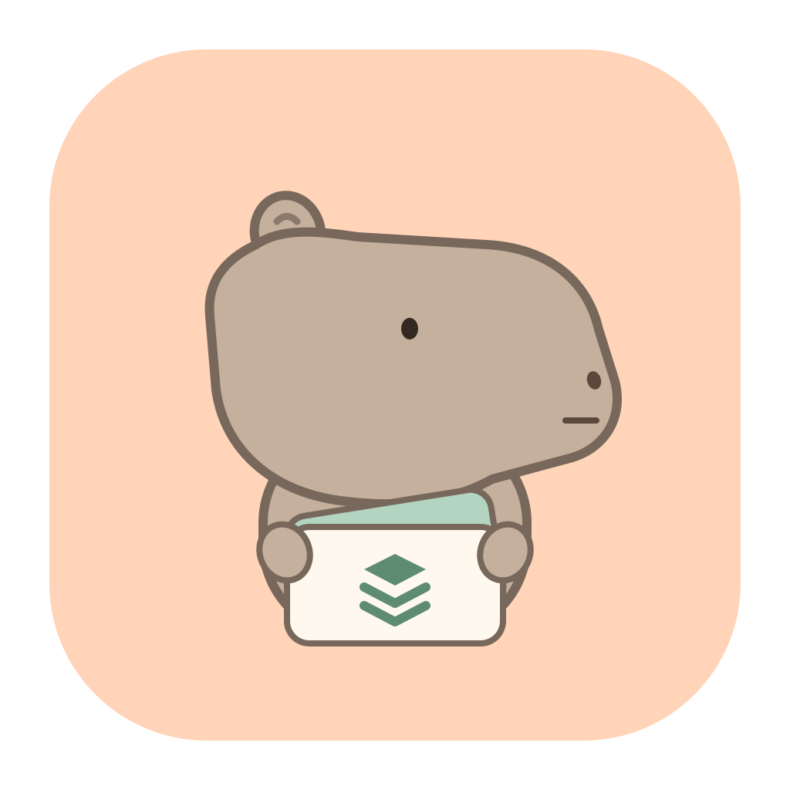

<p align="center">
  
</p>

<h1 align="center">Knack</h1>

<p align="center">管理每个 AI Agent 的技能。</p>

Knack 是一款面向 Windows、Linux 和 macOS 的桌面应用，用来管理本机的 AI Agent skills。把分散在 Claude、Codex、Cursor 等工具中的技能放到一个视图里，查看来源、共享技能、检查断链，并比较同名副本。

以磁盘上的 `SKILL.md` 和目录为准，用共享池与软链连接不同 Agent。

## 功能

| 功能 | 能做什么 |
| --- | --- |
| 技能浏览 | 搜索名称、说明和路径，查看技能正文、所在目录与软链目标 |
| 共享池 | 将本地仓库中的技能链接到 `~/.agents/skills`，再链接到不同 Agent |
| 问题检查 | 发现断链、空目录、未挂出的共享技能；按需比较副本，确认一致或存在差异 |
| 修复与撤销 | 单项处理或批量修复可安全处理的问题，修改前确认，完成后可撤销 |
| 依赖图 | 查看同一技能目录内的依赖关系与缺失节点 |
| 生效视图 | 按 Agent 和工作目录查看同名技能的来源、覆盖关系与分层矩阵 |
| 仓库管理 | 添加本地技能仓库，设置显示名称与扫描路径 |
| Claude 调用设置 | 调整用户级自动调用、仅手动调用或禁用设置 |

Knack 识别 Claude、Codex、Cursor、Factory、Gemini、OpenCode、Pi、Goose 等工具的已知技能目录。只显示本机已存在或需要报告访问错误的目录，自带技能与 `.system` 内容只读。Windows 上也会识别 Goose 的 `%APPDATA%\Block\goose\config\skills`。

生效视图目前按「项目 → 全局 → 共享池 → 内置」推演同名覆盖关系。实际加载行为仍以各 Agent 的规则为准。依赖图中的正文引用包含推断结果。

## 从源码运行

需要 Go 1.27.3 或更新版本。当前已在 macOS Apple Silicon 上验证运行；CI 为 Windows、Linux 和 macOS 生成安装包，Windows、Linux 的实际桌面运行仍需在目标系统验证。

- macOS：使用系统桌面框架。
- Windows：创建技能软链需要开启开发者模式，或以管理员身份运行。
- Linux：需要 GTK 3 桌面环境及相应运行库。Knack 使用原生 UI，打包配置已关闭 WebView，不要求 WebKitGTK。

在项目根目录运行：

```sh
go tool mygo dev
```

项目通过 `go.mod` 管理 [MyGo](https://github.com/egoist/mygo)，无需单独安装全局 MyGo 命令。

### 打包

```sh
go tool mygo build
```

Apple Silicon 构建产物位于 `dist/darwin-arm64/`：

```text
dist/darwin-arm64/
├── Knack.app
└── knack-0.1.0-arm64.dmg
```

也可以指定目标平台；无需 cgo：

```sh
# macOS 通用包，兼容 Apple Silicon 与 Intel；DMG 打包需要在 macOS 执行
go tool mygo build -platform darwin/universal

# Windows 安装包；在 Linux 或 macOS 交叉打包时需要安装 NSIS
go tool mygo build -platform windows/amd64,windows/arm64

# Linux 归档与 Debian 安装包
go tool mygo build -platform linux/amd64,linux/arm64
```

### CI 自动打包

[Build 工作流](.github/workflows/build.yml) 在推送、PR 和手动触发时运行。先在 Windows、Linux 和 macOS 上分别执行测试与 Go vet，并在 macOS 上执行 MyGo UI 检查，通过后并行打包三个系统：

| 系统 | 架构 | Actions 产物 | 安装包 |
| --- | --- | --- | --- |
| macOS | Apple Silicon + Intel 通用包 | `knack-macos-universal` | `.dmg` |
| Windows | x64、ARM64 | `knack-windows` | NSIS 安装程序 `.exe` |
| Linux | x64、ARM64 | `knack-linux` | `.tar.gz`、`.deb`、`install.sh` |

在 GitHub 仓库的 **Actions → Build → 对应运行 → Artifacts** 下载，产物保留 14 天。也可以在 **Run workflow** 中手动触发。

Linux 可直接安装 `.deb`；使用归档时，将对应架构目录里的 `install.sh` 与 `.tar.gz` 放在一起，运行 `sh install.sh`，安装到当前用户目录。

MyGo 使用纯 Go 构建，Windows 与 Linux 包由 Ubuntu runner 交叉编译，Windows 打包前自动安装 NSIS。macOS 通用包由 macOS runner 构建。各平台的包都使用 `mygo.json` 中的版本号和图标。

此流程上传 Actions 产物，不会创建 GitHub Release。不需要签名密钥；macOS 包使用临时签名（ad hoc），未经过 Apple 公证，Windows 包未做代码签名，下载后系统可能提示验证发布者。

### 开始使用

1. 启动后等待扫描，在「共享池」或 Agent 页面浏览已有技能。
2. 在「仓库」分组添加本地目录，将需要的技能挂到共享池。
3. 从共享池将技能挂到目标 Agent，通过软链共用同一份内容。
4. 在「问题」页检查断链与副本，在「生效视图」中选择 Agent 和工作目录查看覆盖关系。

快捷键：`⌘R` 重新扫描，`⌘,` 打开设置。

## 数据与修改

扫描不会改动技能文件，只读取有限的头部元数据；正文在查看详情时加载，副本完整内容对比按需执行。替换副本、修复、移除技能和更改 Claude 调用设置都经过确认，并记录可撤销的操作。替换或移除目录和链接时，会将原对象暂存到撤销记录中，保留 Windows 目录软链和 junction 的类型。同一磁盘使用相对软链；Windows 跨盘链接使用绝对目标。

共享池位于 `~/.agents/skills`。为兼容更名前的数据，Knack 继续使用以下目录：

| 路径 | 用途 |
| --- | --- |
| `~/.config/skill-manager/repos.json` | 本地仓库路径与显示名称 |
| `~/.config/skill-manager/settings.json` | 界面显示设置 |
| `~/.config/skill-manager/undo/` | 撤销记录与暂存内容 |
| `~/.cache/skill-manager/catalog.json` | 启动时展示的扫描缓存 |

Claude 调用设置写入 `~/.claude/settings.json`，保留其他配置，不修改 `SKILL.md`。具体调用行为还可能受到技能、项目或组织设置限制。

## 开发

使用 Go 与 MyGo 构建桌面界面。主要代码分层：

```text
main.go            应用入口与窗口配置
internal/app/      界面、状态与操作协调
internal/skill/    目录扫描、元数据、依赖图与生效视图
internal/manage/   文件修改、软链操作与撤销
internal/repair/   问题修复与移除计划
internal/store/    配置与扫描缓存
resources/         应用图标
```

提交改动前运行：

```sh
go test ./...
go vet ./...
go tool mygo vet .
```

标准测试使用临时目录。读取真实用户目录的 `TestLiveHome` 测试默认跳过，可通过 `SKILL_MANAGER_LIVE=1 go test ./internal/skill -run '^TestLiveHome$'` 手动运行。
